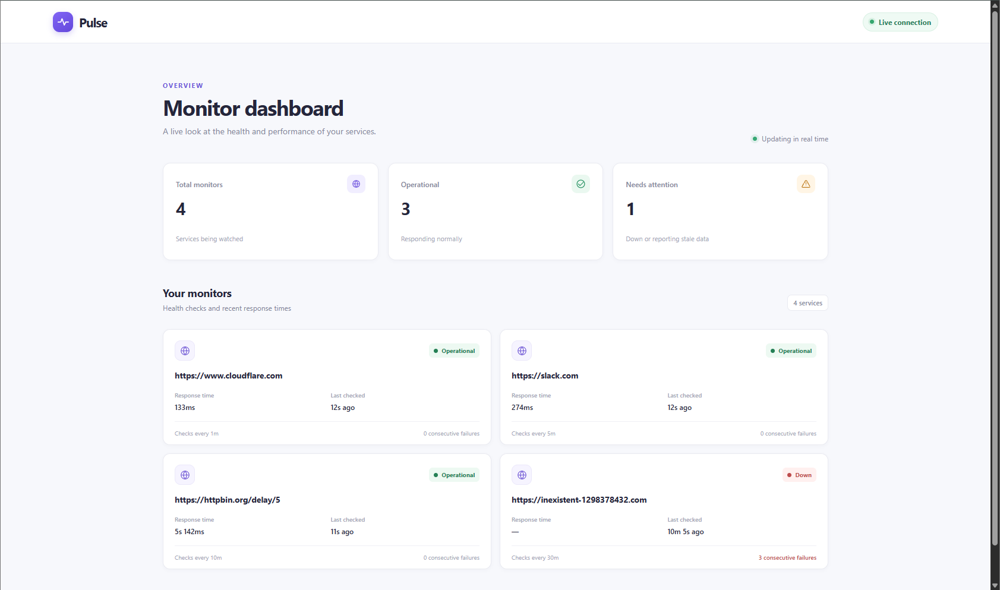
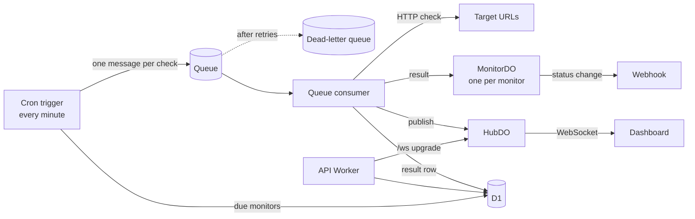

# Pulse

Pulse is an uptime monitor. You add URLs, it checks them every minute, stores the results, and pushes status changes to an open dashboard in real time.

**Live demo:** https://pulse.matheuspuel.workers.dev



This project is an experiment to evaluate the development experience of [Alchemy](https://alchemy.run).

## How it works



Every minute a cron handler finds the monitors that are due and enqueues one message per check. The queue consumer runs the HTTP check, writes the result to D1 and passes it to that monitor's Durable Object. The object decides whether the status changed and sends one alert per change. The consumer also publishes the result to a hub object, which pushes it to every open dashboard over WebSockets.

| Piece        | Job in Pulse                                                             |
| ------------ | ------------------------------------------------------------------------ |
| Worker       | REST API for monitors and check history, WebSocket upgrade               |
| Cron Trigger | Every minute, enqueues the due checks                                    |
| Queue        | One message per check, with retries and a dead-letter queue              |
| D1           | Monitors and check results                                               |
| `MonitorDO`  | Current status, incidents, alert outbox, stale detection                 |
| `HubDO`      | Latest state of every monitor, WebSocket fan-out to dashboards           |
| Axiom        | Receives the Workers' OpenTelemetry traces and logs                      |
| Alchemy      | Declares all of the above as code, with separate `dev` and `prod` stages |

## Conclusions

Alchemy makes it very simple and fast to deploy and update cloud infrastructure correctly. It significantly shortens the development loop.

The abstractions make it easy to design and understand the architecture and help to deploy only what is necessary.

The documentation is comprehensive and explains which cloud resources Alchemy supports, what each is for, and when to use it.

There are no first-class APIs for declaring Effect `Schema`s at the boundaries.
This results in ergonomic problems in encoding/decoding with type safety when dealing with objects that are not JSON-compatible, like classes.

## Design decisions

- **Idempotency key: monitor + scheduled minute.** Queue delivery is at least once, so `checks` has a unique key on that pair and inserts ignore conflicts. The minute comes from the cron's scheduled time, not the current time, so a retry produces the same key.
- **A down website is a result, not a failure.** Timeouts and error statuses are stored as failed checks. Only infrastructure errors make a message retry.
- **One Durable Object per monitor.** Each monitor gets its own serialized state, with no global bottleneck. The object ignores results older than the last one it applied, which absorbs redeliveries and late messages.
- **Status rules are a pure function.** `step(state, result)` returns the new state and an optional transition, so the rules are unit-tested without Cloudflare.
- **One hub object for the dashboard.** The browser opens a single socket. On connect the hub sends a snapshot, then deltas, so a tab that was offline never shows stale data.
- **Shared protocol.** One Effect `Schema` module describes the WebSocket messages and is used by both the Worker and the dashboard.

## Cautions

### Durable Objects

A Durable Object is single-threaded. It runs one call at a time, but it only holds while the call is using storage and synchronous operations. Any await on something outside storage, like a `fetch`, lets other calls run in between.
Reads and writes through the storage API are protected by input gates, so a read followed by a write is safe. Anything else you await is not, so re-check state after it.

Atomicity is separate from isolation. Each storage call is atomic on its own, but a sequence of calls is all-or-nothing only if Cloudflare batches the writes (no `await` between them) or you wrap them in a transaction.
Transactions only cover the object's own storage: not HTTP calls, other objects, or JavaScript variables. So persist the intent first (the outbox), then do the external call, and make it safe to repeat.

### WebSockets

To reduce incurred costs, hibernation lets a Durable Object be evicted from memory while its WebSocket clients stay connected.
After a wake-up the constructor runs again and everything in memory is gone. State has to live in storage or in a socket attachment.
Rebuild the session list from `getWebSockets()` each time the object wakes.

## Failure experiments

### Duplicate delivery

A consumer may throw after writing the result but before it acknowledges, potentially duplicating the results.
The solution is to make the consumer idempotent.
Depending on the implementation, the handler may stop when a duplicate key is identified, or it may run again but the results are discarded.

### Poison message

If some message has a problem that makes the consumer always fail, this message will be dropped after the retry limits.
So a good practice is to move these problematic messages to a separate queue, called a dead-letter queue.
It frees the main queue and prevents losing messages.
The messages in a dead-letter queue can then be analyzed to identify and fix the problem, and can later be reprocessed.

### Slow target

Having messages that take long to be processed may cause subsequent messages in the batch to wait and cause messages to accumulate in a queue.
When messages pile up, Cloudflare scales consumers, draining the queue.
We can adjust some parameters like timeouts, batch size, retry limit and concurrency.

## Run it yourself

Prerequisites: Node.js 24.11.1 or newer (or Bun), pnpm, and a Cloudflare account.

```bash
git clone https://github.com/matheuspuel/pulse-alchemy-cloudflare.git && cd pulse-alchemy-cloudflare
pnpm install
pnpm alchemy profile edit --add Cloudflare   # sign in
pnpm alchemy dev                             # Workers run locally, resources in your dev stage
pnpm alchemy deploy                          # deploy your own dev stage
pnpm alchemy deploy --stage prod             # deploy production
```

## Tech

TypeScript, Effect, Cloudflare Workers, D1, Queues, Durable Objects, Alchemy, Axiom, React, Vite, Vitest.
